# PSP Shelf Launcher

**Shelf** is a home screen and game launcher for the PSP on ARK-5 custom firmware. It lists your PSP games, PS1 games and homebrew, remembers what you are playing, and shows what the plugins from [psp-ark-plugins](https://github.com/00KAM1/psp-ark-plugins) have recorded about each game: Sidequest save states, the Checkpoint journey and play time, and Emblem achievements.

Shelf runs on its own. The plugins are optional, and each one adds something to it.

| | |
|---|---|
| Version | 1.1 |
| Build | Nov 24 2026 13:32:47 |
| Tested on | PSP-3000, firmware 6.61, ARK-5 |

> **Disclosure.** Shelf was written by Claude, Anthropic’s AI model, from my ideas and my testing on a PSP-3000. I’m not a PSP programmer, and nothing has been tested beyond my own console. Please read the [known issues](docs/known-issues.md) before relying on it.

<p align="center">
  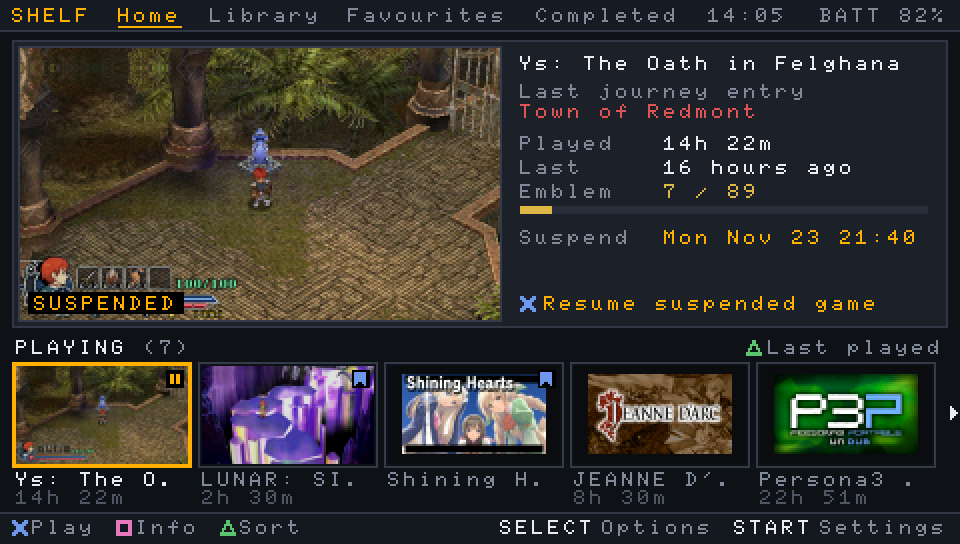
  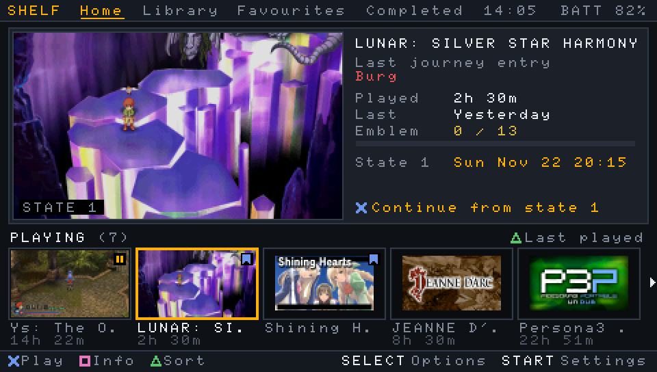
</p>

## What it does

- **Four tabs.** Home (the games you have started, with the picture of the newest save state), Library (a grid of everything, by category), Favourites and Completed. Home, Favourites and Completed can each be switched off.
- **Categories from your folders.** One category for each folder your games sit in below `ISO/` and `PSP/GAME/`.
- **Per-game information.** Emblem progress and the latest unlocks, then the Checkpoint journey, on two pages.
- **It is the launcher.** Shelf installs itself as ARK's Custom Launcher, so quitting a game comes back to Shelf, and it can start at power on.
- **A PS-button menu.** USB connection, Settings, Restart, Shut down, Sleep and Exit to XMB, plus how long the PSP has been on and what that cost in battery.
- **Settings in one place.** Shelf's own settings, ARK-5's settings and your `PLUGINS.TXT` lines.

<p align="center">
  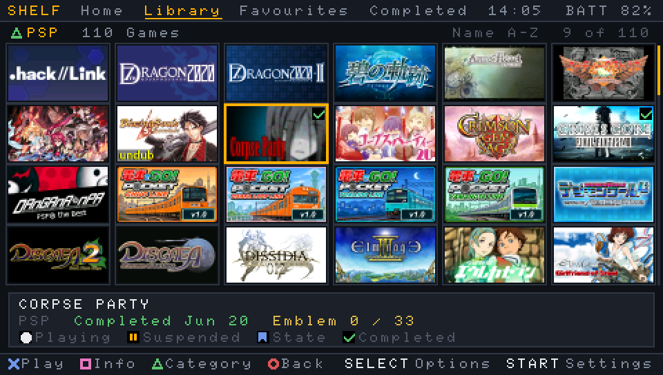
  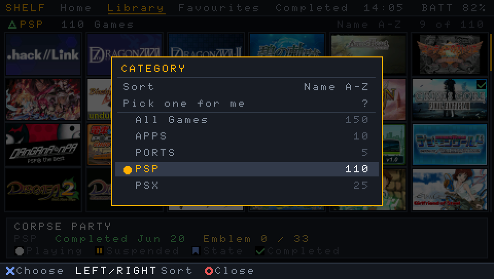
  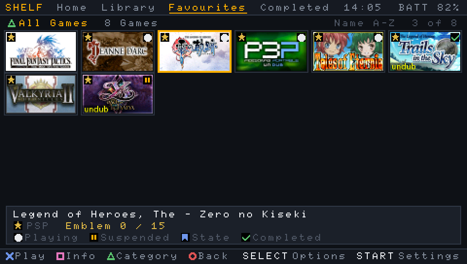
</p>

<p align="center">
  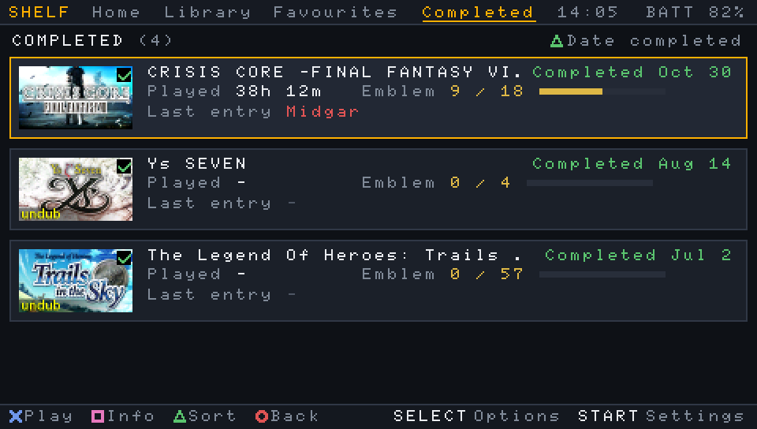
  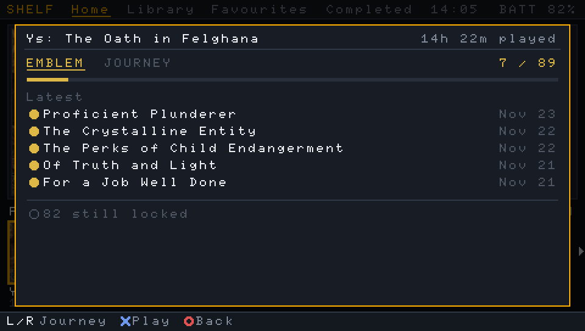
  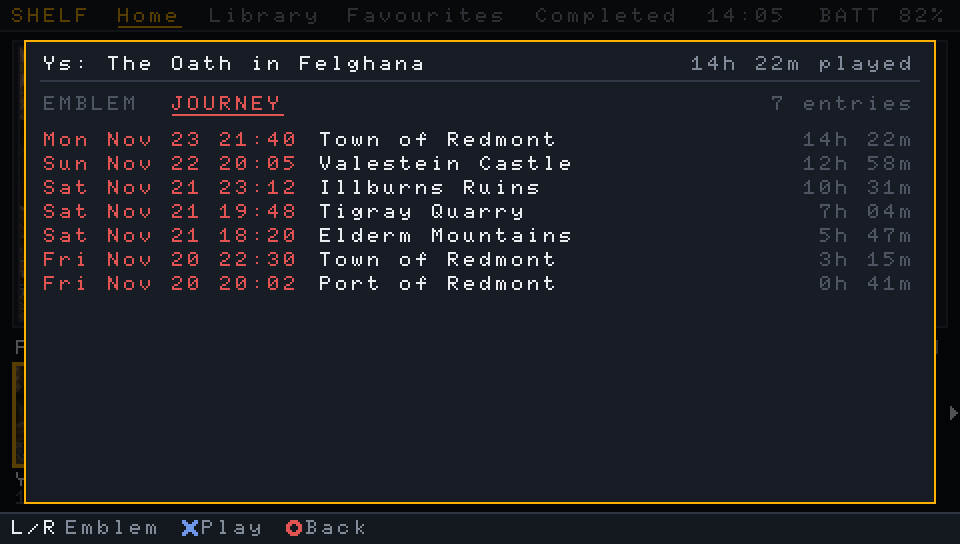
</p>

<p align="center">
  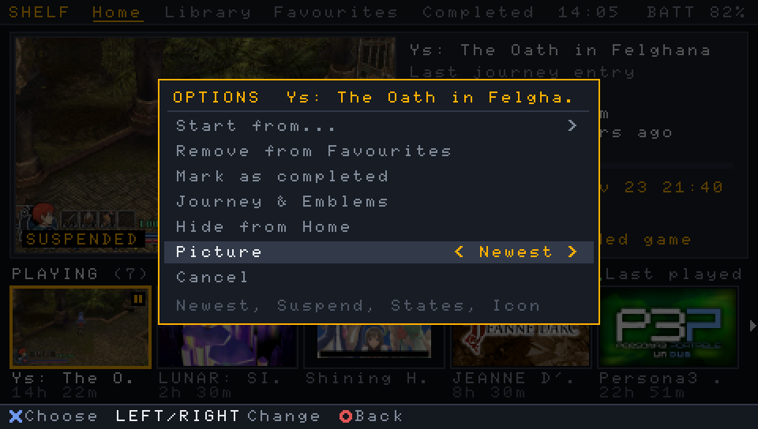
  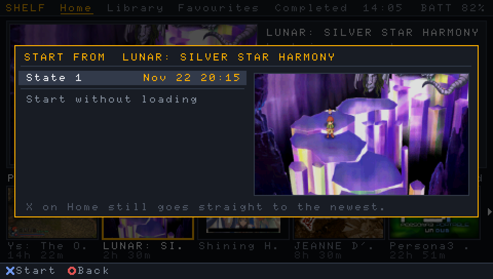
  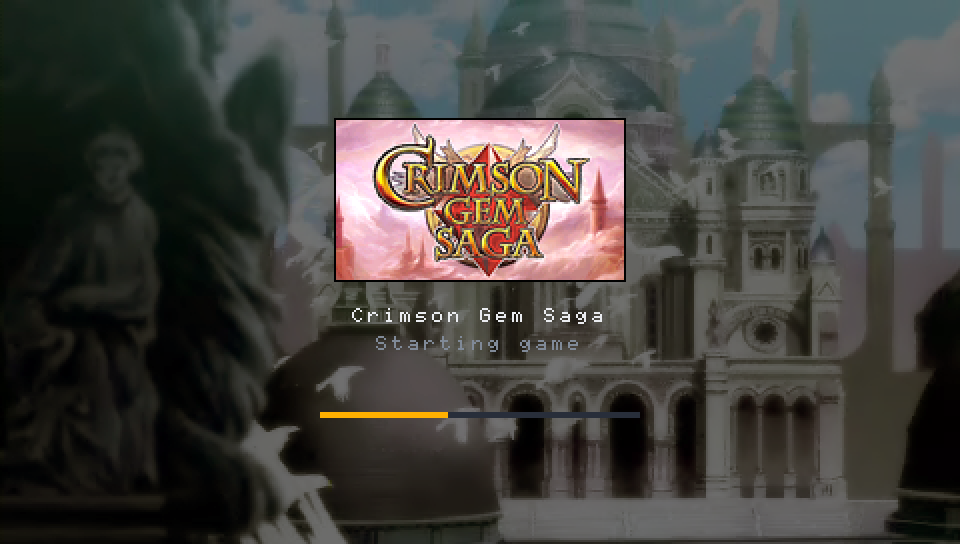
</p>

<p align="center">
  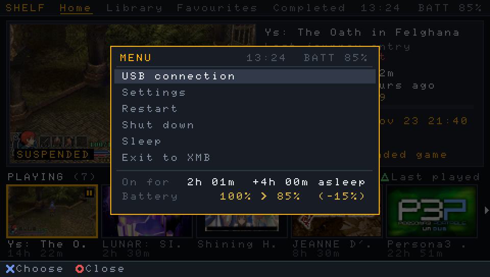
  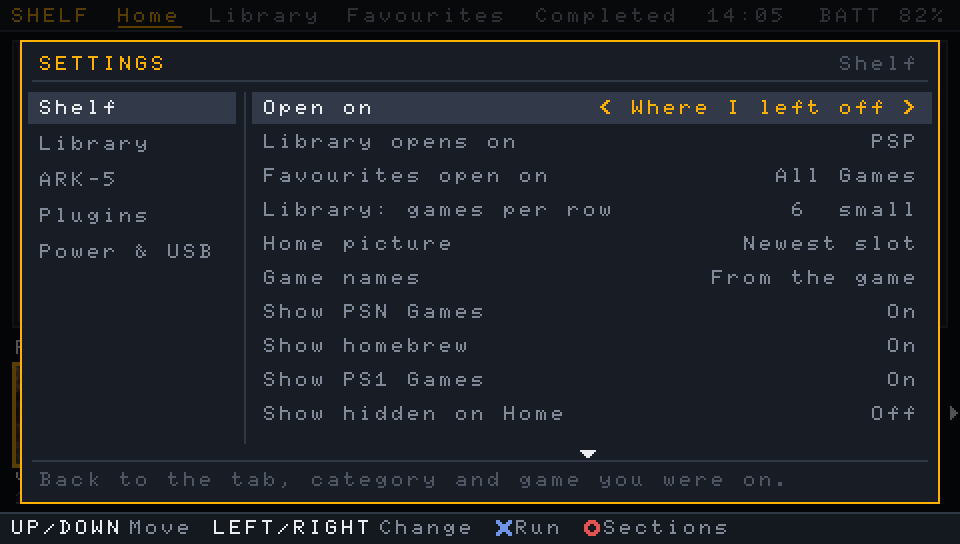
</p>

*The pictures on this page are drawn on a PC by Shelf's own drawing code, from the icons and pictures of my own games. They are not photos of a PSP. The two save-state pictures on Home and in "Start from..." are from my own states. The play times, journey entries and unlocks are example data.*

*The game icons and pictures are the artwork of the games' publishers. They are not part of Shelf and not covered by its licence.*

**Requirements:** a PSP on ARK-5. It has been tested on a PSP-3000 on firmware 6.61 only.

**Documentation:** [Manual](docs/manual.md) · [Known issues and test status](docs/known-issues.md) · [How it works](docs/how-it-works.md) · [Changelog](CHANGELOG.md)

## Works with the plugins

The plugins are in their own repository, [psp-ark-plugins](https://github.com/00KAM1/psp-ark-plugins). Emblem, Sidequest, Checkpoint and Scanline work without Shelf. Runtime is built for Shelf and shows nothing without it.

| Plugin | What Shelf uses |
|---|---|
| **Sidequest** | The picture and date of the newest save state or suspend. A game started from Home goes straight back to that state, without Sidequest's question. That needs Sidequest 1.2 or later. |
| **Checkpoint** | The journey log and time played. |
| **Emblem** | Achievement progress and the latest unlocks. |
| **Runtime** | Time on and battery use counted in every program, with sleep counted apart. Without it Shelf keeps a simpler count itself. |

### Resuming a game and save states

> [!WARNING]
> **Due to limitations in the way save states are saved and restored, a state is only safe to load on the setup it was made on. Delete your old states before you install or update anything.**
>
> A Sidequest state is a copy of the whole running system at that moment: the game, the launcher, and every plugin in the version that was installed then. Loading it brings all of that back. This is the same whether you load from Sidequest's menu or resume a game from Shelf's Home tab.
>
> A state made **before** you installed or updated Shelf, [Sidequest](https://github.com/00KAM1/psp-ark-plugins#sidequest), any other plugin, or ARK no longer matches what is on the Memory Stick. Loading one can:
>
> - end in a **black screen** instead of the launcher when you quit the game;
> - run the **old versions** of the plugins, or run without a plugin you have added since, until the game is restarted;
> - leave **files on the Memory Stick damaged**. On my PSP, Shelf's saved game list and logs were damaged after loading such a state.
>
> **Every time you install or update:**
>
> 1. Save in each game the normal way, from the game's own save menu.
> 2. Delete every state. △ in Sidequest's menu deletes the selected slot, the suspend included, and L / R there shows your other games' slots. With a computer, deleting the game folders inside `ms0:/SIDEQUEST/` (keeping `config.txt`) does the same in one go.
> 3. Install the new files, then take new states.
>
> If a load ends in a black screen, hold POWER up for ten seconds to switch off. More in the [known issues](docs/known-issues.md).

**If that risk is more than you want, run Shelf without Sidequest.** Shelf does not need it. The Home screen, Library, Favourites, Completed, the game pictures, the journey log from Checkpoint, Emblem's achievements, settings and USB all work the same, and so do the other plugins. A game on Home then shows its own picture and starts from the beginning, where you load your save in the game as usual. What you give up is the save-state picture on Home and going straight back to a state. To leave Sidequest out, do not install `sidequest.prx` or its line in `PLUGINS.TXT`.

## Install

Download the newest `psp-shelf-launcher` zip from the [Releases](../../releases) page and unpack it.

1. Copy its `PSP` folder onto the Memory Stick, merging with the one there. That puts two copies of the same program in place:
   - `PSP/SAVEDATA/ARK_01234/VBOOT.PBP`: Shelf as ARK's Custom Launcher
   - `PSP/GAME/SHELF/EBOOT.PBP`: Shelf as an icon under Game > Memory Stick
2. Open "Custom Launcher" in the XMB's Game column, or the Shelf icon.
3. To boot straight into Shelf, turn on Settings > Shelf > "Start Shelf at power on".

`VBOOT.PBP` replaces the launcher that is there now. The file it replaces is kept once as `VBOOT_BEFORE_SHELF.PBP`.

**If you use Sidequest, delete your existing states before installing or updating Shelf.** A state saved under the old launcher or an older build can end in a black screen or damage files. See the warning under [Resuming a game and save states](#resuming-a-game-and-save-states).

## Buttons at a glance

| Button | Action |
|---|---|
| L / R | Home, Library, Favourites, Completed |
| X | Play |
| □ | Info: Emblem, then the journey |
| △ | Sort (Home, Completed) or the category menu (Library, Favourites) |
| O | Back to Home; closes menus |
| SELECT | Options for the game |
| START | Settings |
| PS button | Shelf's menu |

## Building from source

Needs the [pspdev toolchain](https://github.com/pspdev/pspdev/releases/tag/latest) and ARK-5's development libraries (`libarkctrl`, `libpspsystemctrl_user`, `libpspkubridge`).

```
export PSPDEV=/path/to/pspdev
export PATH=$PSPDEV/bin:$PATH
make
```

That gives `EBOOT.PBP`. The launcher copy `VBOOT.PBP` is the same file under another name.

The PC tests need gcc and Python 3 with pillow, pycdlib and lz4:

```
cd tests && ./run_tests.sh
```

They build a stand-in Memory Stick, run Shelf's code against it with AddressSanitizer, and write every screen to `tests/out`.

## Licence

MIT. See [LICENSE](LICENSE).

Shelf includes lodepng (zlib licence, [LICENSE-lodepng.txt](LICENSE-lodepng.txt)) and glyphs from Fusion Pixel Font (SIL Open Font License 1.1, [LICENSE-FONT.txt](LICENSE-FONT.txt)).

The game icons and pictures that appear in the screenshots under `docs/images` are the artwork of the games' publishers, shown the way Shelf displays them from my own copies of those games. They are not covered by Shelf's licence, and no game files are in this repository.

## Thanks

Shelf exists because other people shared their work first.

| Thanks to | For |
|---|---|
| The **ARK-5** and **ARK-4** teams ([PSP-Arkfive](https://github.com/PSP-Arkfive), [PSP-Archive/ARK-4](https://github.com/PSP-Archive/ARK-4)) | The custom firmware Shelf runs on, and the Custom Launcher slot it lives in. The source and documentation of their own launcher, arkMenu, showed how a launcher starts games and reads ARK's settings. |
| **psp5** by 08Weber ([github.com/08Weber/psp5](https://github.com/08Weber/psp5)) | A launcher for the same firmware. Its documentation and source were read to understand how a custom launcher for ARK is put together. |
| **pspdev** ([github.com/pspdev](https://github.com/pspdev)) | The toolchain and the PSPSDK that Shelf is built with. |
| **lodepng** by Lode Vandevenne, and **Fusion Pixel Font** with the **Misaki** font by Num Kadoma | Reading the games' pictures, and the Japanese text. |

No code was copied from psp5 or arkMenu; both were read as references.

The plugins that fill Shelf's screens are in [psp-ark-plugins](https://github.com/00KAM1/psp-ark-plugins).
