# Shelf 1.2: user guide

Build Nov 26 2026 09:00:17. For a PSP on ARK-5.

## Install

Copy the `PSP` folder from the release zip onto the Memory Stick and let it merge with the one there. That puts in place:

| File | What it is |
|---|---|
| `PSP/SAVEDATA/ARK_01234/VBOOT.PBP` | Shelf as ARK's Custom Launcher |
| `PSP/GAME/SHELF/EBOOT.PBP` | Shelf as an icon under Game > Memory Stick |

The two files are the same program. `VBOOT.PBP` replaces the launcher that is there now. The copy in `PSP/GAME` is optional: keep it if you want Shelf's own icon in the Game menu.

"Custom Launcher" in the XMB's Game column now opens Shelf, and games come back to it. To boot straight into Shelf, turn on Settings > Shelf > "Start Shelf at power on".

When you update, copy the new files over the old ones. Your settings, completed marks, favourites and Sidequest slots carry over. A new build only runs after a restart of Shelf.

**Delete your Sidequest states before you install or update.** A state remembers the launcher and plugins as they were when it was saved. One from before an install or update of Shelf, a plugin or ARK can end in a black screen instead of Shelf, run old plugin versions, or leave files on the Memory Stick damaged, whether you load it from Sidequest's menu or by resuming from Home. Save in the game's own save menu, delete every state, install, then take new ones. The [known issues](known-issues.md) have the details.

## Screens

| Button | Does |
|---|---|
| L / R | Home, Library, Favourites, Completed |
| X | Play |
| Square | Info (two pages, see below) |
| Triangle | Home and Completed: sort. Library and Favourites: the category menu |
| O | Back to Home from the other tabs; closes menus |
| SELECT | Options for the selected game |
| START | Settings |
| PS button | Shelf's menu |

The bar at the bottom lists only the buttons that do something on the screen you are on: the four face buttons on the left, SELECT and START together on the right. The PS button is not listed.

### Home

<p align="center">
  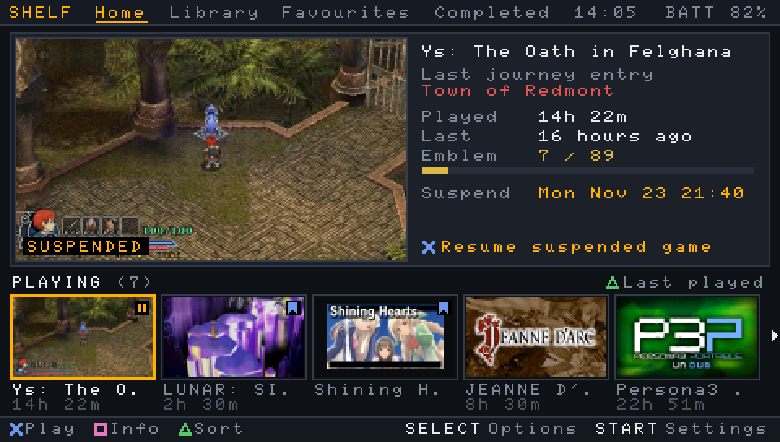
  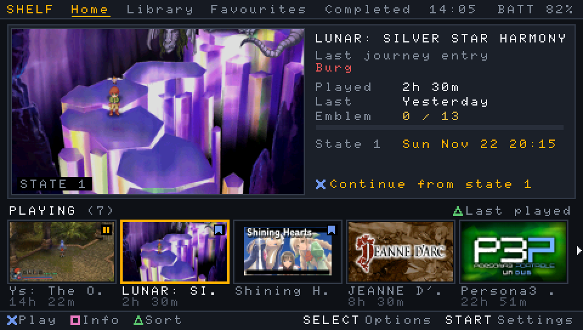
  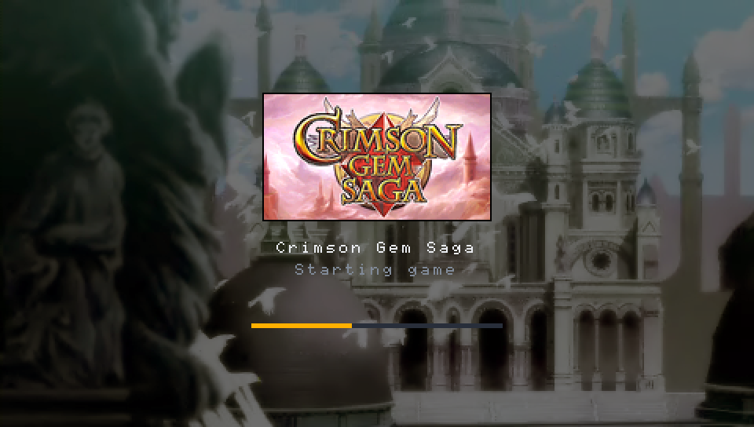
</p>

The games you have started: those with a Sidequest slot or a Checkpoint journey. The large picture is the newest save state or suspend of the selected game. A label on it says what X will go back to, SUSPENDED or STATE 3, and the text beside X says the same; a game with no slot has no label and reads "Start game". The row of games is headed PLAYING. On a game's tile, two bars mean the newest slot is a suspend and a blue flag means it is a state.

While a game starts, Shelf shows the game's own picture at full size (the third picture above).

A game started from Home that has a Sidequest slot goes straight back to its newest slot; Sidequest does not ask "Continue where you left off?" first. The game still starts first and the state loads a few seconds in. That is how save states work: a state can only be loaded back into the running game. Started from All, Favourites or Completed, Sidequest asks as before. This needs Sidequest 1.2 or later; with an older one the question shows everywhere.

### Library

<p align="center">
  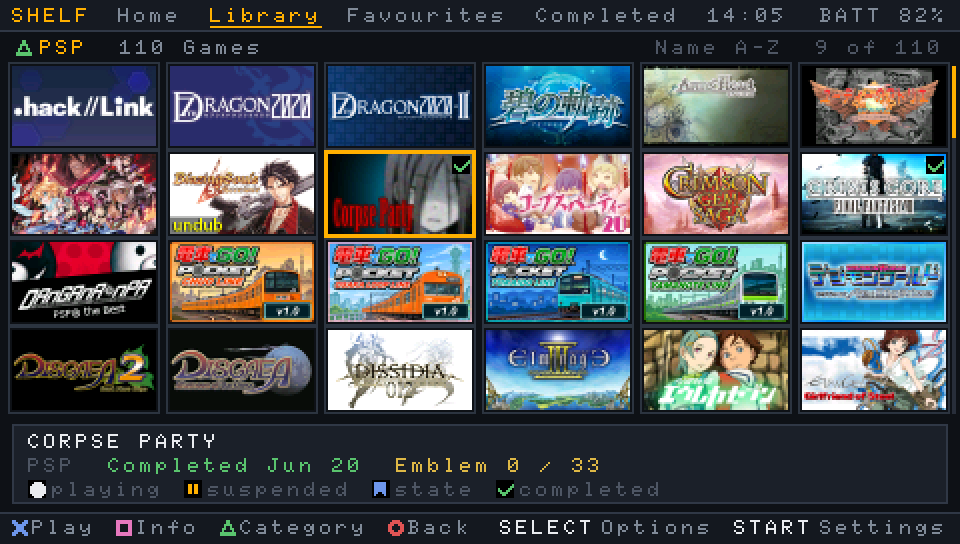
  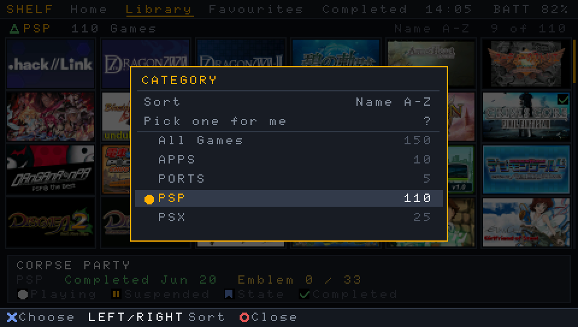
</p>

A grid of every game. The d-pad and the stick move in all four directions. Triangle opens a menu:

- **Sort.** LEFT/RIGHT changes it, also from any other row.
- **Pick one for me.** Lands on a game you have not started. The menu opens on this row again next time.
- **Categories**, each with its number of games. X chooses one.

Categories are All Games first, the rest in name order:

- one for each folder your games are in below `ISO/` and `PSP/GAME/` (APPS, MINIS, PORTS, PSP, PSX and so on; a `CAT_` prefix is dropped). New folders show up at the next scan.
- **PSP Games**, only when there is no folder called PSP
- **PS1 Games**, only when there is no folder called PS1 or PSX
- **Other Homebrew**, homebrew that is in no folder
- **Other PSP Games**, PSP games that are in no folder

Games per row is set in Settings > Shelf: 6, 5, 4 or 3. Library opens on "PSP Games" every time Shelf starts (your folder PSP when there is one). Change it in Settings > Shelf > "Library opens on".

### Favourites

<p align="center">
  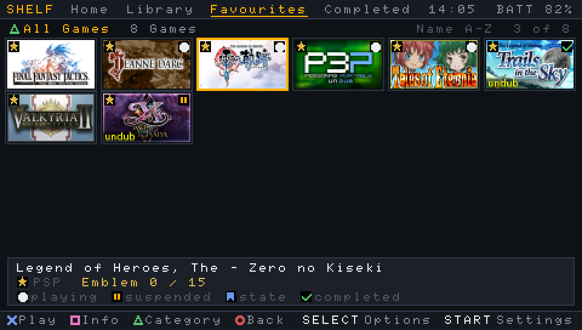
  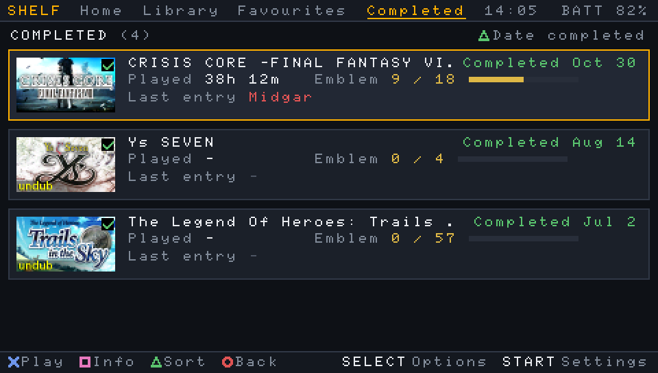
</p>

A tab of its own. SELECT on any game > "Add to Favourites" puts it there; the same row takes it out again. Triangle opens the same menu as on Library, listing only the categories that hold a favourite. Favourites has its own sort order. It opens on All Games every time Shelf starts; change that in Settings > Shelf > "Favourites open on".

### Completed

Games you marked with SELECT > "Mark as completed", with the date. "Mark as not completed" on the same row takes a game out again.

### Info (Square)

<p align="center">
  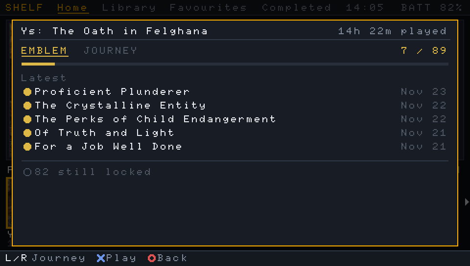
  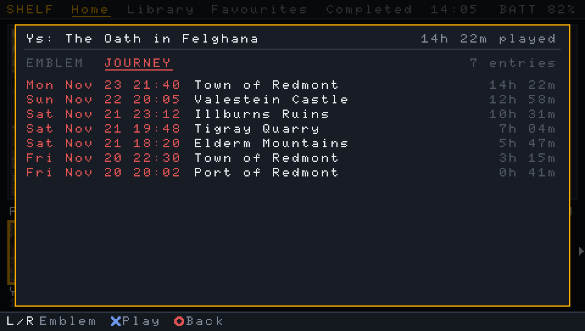
</p>

Two full-width pages. L / R switches between them.

1. **Emblem:** the count, a progress bar, the latest five unlocks with their dates, and how many are still locked.
2. **Journey:** one line per Checkpoint entry with date, place and time played. UP / DOWN turns the pages when there are more than 14 entries.

A game with no Emblem file but with journey entries opens on the Journey page.

### Options (SELECT)

<p align="center">
  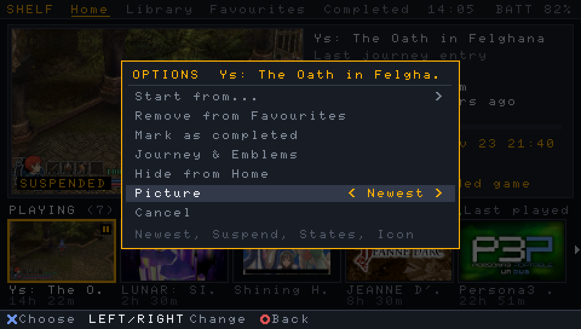
  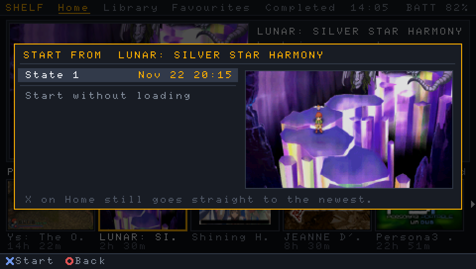
</p>

In this order: Start from... (for a game with a Sidequest slot), Add to / Remove from Favourites, Mark as completed / not completed, Journey & Emblems, Hide from Home / Show on Home, Picture (which save state Home shows, for games with Sidequest slots), Cancel.

**Start from...** lists the game's Sidequest slots, newest first, each with its date and picture, and "Start without loading" below them. X starts the game from the one you choose; "Start without loading" also skips Sidequest's question. X on Home still goes straight to the newest slot. This needs Sidequest 1.2.

### PS-button menu

<p align="center">
  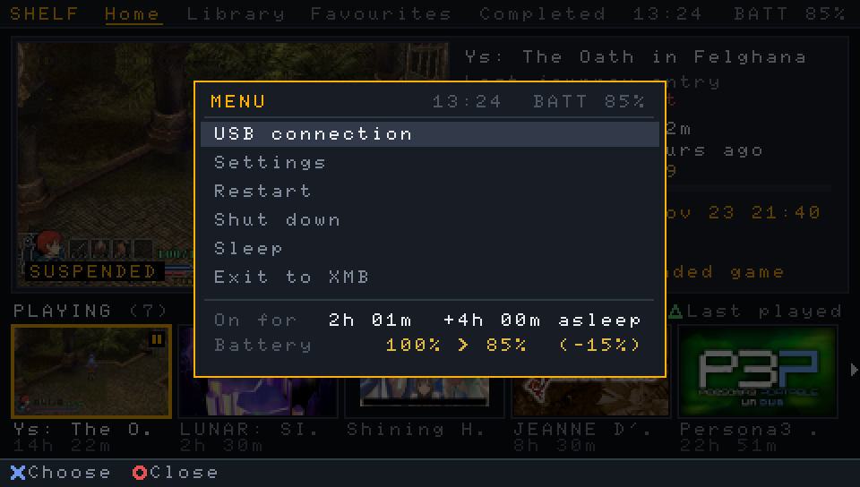
  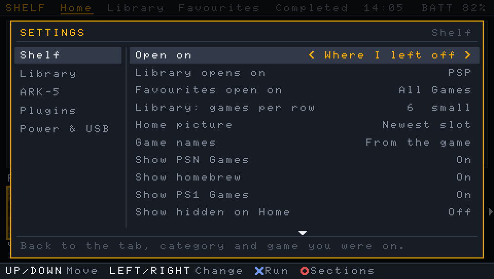
</p>

USB connection, Settings, Restart, Shut down, Sleep, Exit to XMB. Under them: how long the PSP has been on, and the battery then and now. The second picture is Settings, described [below](#settings-start).

If Shelf ever stops responding, the PSP's own "quit the game?" screen comes back on the PS button after 3 seconds.

## Tabs on and off

Settings > Shelf, at the bottom: "Home tab", "Favourites tab", "Completed tab", each On or Off. Library always shows. A tab that is off is gone from the top bar and from L / R. Nothing is deleted: favourites and completed marks are kept and come back with the tab.

- **Home off:** Shelf opens on Library, O goes back to Library (and does nothing on Library), "Hide from Home" leaves Options, and no game resumes without Sidequest's question.
- **Favourites off:** "Add to Favourites" leaves Options.
- **Completed off:** "Mark as completed" stays in Options. A completed game leaves Home and keeps its tick on Library.

## Settings (START)

Opens on the list of sections. UP/DOWN picks a section; X or RIGHT goes in. Inside: UP/DOWN moves, LEFT/RIGHT changes, X runs. O goes back to the sections; O there saves and closes.

| Section | Holds |
|---|---|
| Shelf | Open on (a tab, or where you left off), Library opens on, Favourites open on, games per row, Home picture, game names, which kinds of game show, show hidden on Home, Start Shelf at power on, After a game, the three tabs on/off |
| Library | Rescan, rebuild pictures; totals: games by kind, started and completed, time played, Emblems, favourites, Memory Stick space |
| ARK-5 | CPU clock, extra memory, USB charge, MS cache, skip logos, hide PIC0/PIC1, hide MAC, hide DLC, LED, UMD drive, analog, WPA2. Writes ARK's `SETTINGS.TXT`; per-game lines are left alone |
| Plugins | Turns each line in `PLUGINS.TXT` on or off |
| Power & USB | USB connection, sleep, restart, shut down, exit to XMB, ARK recovery |

If ARK or plugin files changed, Shelf offers a restart when you close Settings. Sidequest needs ARK-5 > Extra memory Off.

## Shelf is the launcher

Shelf puts a copy of itself in as ARK's launcher file (`VBOOT.PBP`), so quitting a game comes back to Shelf (Settings > Shelf > After a game: Back to Shelf / XMB). If ARK's launcher setting was on with another launcher, Shelf takes its place the first time it starts. The launcher file Shelf replaced is set aside once as `VBOOT_BEFORE_SHELF.PBP` in ARK's folder. Shelf never uses it; delete it if you like.

The PSP powers on into the XMB unless "Start Shelf at power on" is on. With it on, Exit to XMB turns ARK's launcher setting off so the XMB can show; it stays off until Shelf is next opened from the XMB.

## Opened from the Game menu

The Shelf icon under Game > Memory Stick hands over at once to the launcher copy.

Starting from the icon is therefore slower than you might expect: the PSP loads Shelf, restarts into the launcher copy and loads it again, with a black screen in between. This is on purpose, so that every menu and the PS button work the same however Shelf was started. Custom Launcher and "Start Shelf at power on" go straight to the launcher copy and do not have this extra step.

Why: plugins that treat any `EBOOT.PBP` as a game load into the Game-menu copy. Checkpoint, for one, then takes the PS button before Shelf's menu. They stay out of the launcher copy.

Hold L while Shelf starts to stay in the Game-menu copy, for example if the launcher copy ever fails to come up. `ms0:/SHELF/shelf.log` says which way each start went.

## USB connection

PS button > USB connection, or Settings > Power & USB. Eject the PSP on the computer before pressing O to leave USB mode. When you leave, Shelf rescans the Memory Stick: new games appear, removed ones go, pictures are reloaded.

You can copy a new Shelf build over the old files while in USB mode. The new build runs after the next restart of Shelf.

## On for / Battery

In the PS-button menu. "On for" is the time since the PSP was powered on, games included. "Battery" is the level then and now, and the difference. With the Runtime plugin the figures come from its record in `ms0:/RUNTIME/`; if that record cannot be read, the two lines are left out of the menu. When a power-on ends, one line about it goes into `battery.log` (in `ms0:/SHELF/` for Shelf's own count, in `ms0:/RUNTIME/` with Runtime):

```
Tue Nov 24 09:10 to Tue Nov 24 13:24 | 4h 14m | battery 100% to 53% | -47%
```

Without the Runtime plugin, Shelf keeps this count itself: it notes the time and battery every 5 minutes and whenever it hands over to a game, the XMB or a restart. Counting that way, time asleep counts as "on", and a power-off during a game or in the XMB is not noticed until up to 12 hours later.

With the Runtime plugin (from [psp-ark-plugins](https://github.com/00KAM1/psp-ark-plugins)) running, Shelf shows Runtime's numbers, with sleep apart ("On for 2h 01m  +4h 00m asleep"), and stops writing the count itself.

## Files Shelf keeps

All in `ms0:/SHELF/`:

| File | Holds |
|---|---|
| `config.txt` | Settings and where you left off |
| `games.txt` | Completed, favourite, hidden and picture choices per game |
| `CACHE/` | Pictures read from your games; safe to delete, rebuilt at the next scan |
| `uptime.txt`, `battery.log` | Time on and battery, Shelf's own count (Runtime keeps its record in `ms0:/RUNTIME/`) |
| `shelf.log` | What each start did; the first place to look when something is wrong |
